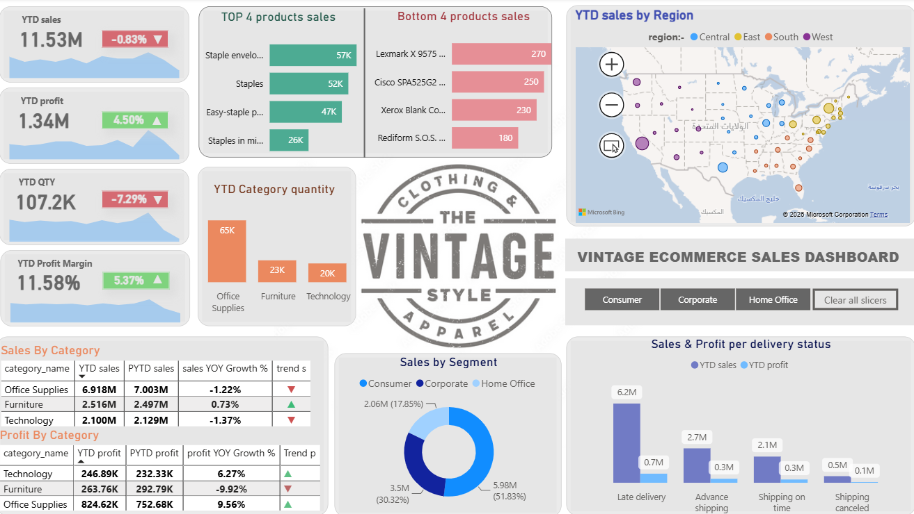

Vintage-Sales-Analysis

Power BI Dashboard for Vintage Store Sales Analysis, covering sales performance, profitability, product categories, customer segments, and shipping trends



# Vintage Sales Analysis | Power BI
The goal was to get a clearer picture of the store's sales and profit performance, understand which products and categories perform best, and explore customer segments and delivery trends.


## Key Metrics

| Metric | Value |
|---|---:|
| YTD Sales | 11.53M |
| YTD Profit | 1.34M |
| YTD Quantity | 107.2K |
| Profit Margin | 11.58% |
| Sales Growth | -0.83% |
| Profit Growth | +4.50% |
| Quantity Growth | -7.29% |

## What the Dashboard Covers

- Overall sales, profit, and quantity performance.
- Best and lowest-performing products by sales.
- Sales across different regions.
- Sales and profit by product category.
- Customer segments: Consumer, Corporate, and Home Office.
- Sales and profit across different delivery statuses.
- Year-to-date performance compared with the previous year.

## Business Insights

A few interesting findings from the analysis:

- Total sales reached 11.53M, with 1.34M in profit.
- Sales decreased slightly by 0.83%, while profit increased by 4.50%.
- Office Supplies generated the highest sales, reaching 6.918M.
- Technology recorded the highest profit growth at 6.27%.
- Consumer customers contributed the largest share of sales (51.83%).
- Late deliveries accounted for approximately 6.2M in sales.

## Recommendations

Based on these findings, a few areas are worth looking into:

- Investigate the reasons behind the decline in sales and quantity.
- Look into the Furniture category, where profit declined by 9.92%.
- Continue focusing on the Consumer segment while exploring opportunities in other customer segments.
- Review delivery performance, especially late deliveries, to identify areas for improvement.
- Keep monitoring product performance to make better inventory decisions.

## Tools & Skills

**Tools:**
- Microsoft Power BI

**Skills:**
- Data Analysis
- Data Visualization
- Dashboard Development
- KPI Analysis
- Sales & Profitability Analysis
- Customer Segmentation
- Business Intelligence

## Project Structure

```text
Vintage-Sales-Analysis/
│
├── Vintage-Sales-Analysis.pbix
├── Dashboard-Overview.png
└── README.md
```

---

# تحليل مبيعات متجر Vintage باستخدام Power BI

## نبذة عن المشروع

هذا المشروع عبارة عن لوحة معلومات تفاعلية أنشأتها باستخدام Power BI لتحليل مبيعات متجر Vintage الإلكتروني.

كان الهدف هو فهم أداء المبيعات والأرباح بشكل أوضح، ومعرفة المنتجات والفئات الأفضل أداءً، بالإضافة إلى تحليل شرائح العملاء واتجاهات التوصيل.

## مؤشرات الأداء الرئيسية

| المؤشر | القيمة |
|---|---:|
| المبيعات | 11.53 مليون |
| الأرباح | 1.34 مليون |
| الكمية المباعة | 107.2 ألف |
| هامش الربح | 11.58% |
| نمو المبيعات | -0.83% |
| نمو الأرباح | +4.50% |
| نمو الكمية | -7.29% |

## محتويات لوحة المعلومات

- متابعة أداء المبيعات والأرباح والكميات.
- أفضل وأقل المنتجات مبيعًا.
- توزيع المبيعات حسب المناطق.
- تحليل المبيعات والأرباح حسب فئات المنتجات.
- تحليل شرائح العملاء: المستهلكون والشركات والمكاتب المنزلية.
- تحليل المبيعات والأرباح حسب حالة التوصيل.
- مقارنة الأداء الحالي بالفترة السابقة.

## أهم النتائج

من أبرز النتائج التي ظهرت أثناء التحليل:

- بلغت المبيعات 11.53 مليون، والأرباح 1.34 مليون.
- انخفضت المبيعات بنسبة 0.83%، بينما ارتفعت الأرباح بنسبة 4.50%.
- حققت فئة مستلزمات المكاتب أعلى مبيعات بقيمة 6.918 مليون.
- سجلت فئة التكنولوجيا أعلى نمو في الأرباح بنسبة 6.27%.
- ساهم قطاع المستهلكين بأكبر نسبة من المبيعات، وهي 51.83%.
- بلغت مبيعات الطلبات ذات التوصيل المتأخر حوالي 6.2 مليون.

## التوصيات

بناءً على النتائج، هناك بعض الجوانب التي تستحق المزيد من الاهتمام:

- دراسة أسباب انخفاض المبيعات والكميات المباعة.
- مراجعة أداء فئة الأثاث، حيث انخفضت أرباحها بنسبة 9.92%.
- الاستمرار في الاهتمام بقطاع المستهلكين، مع البحث عن فرص للنمو في القطاعات الأخرى.
- مراجعة أداء التوصيل، خصوصًا الطلبات المتأخرة.
- متابعة أداء المنتجات لتحسين قرارات إدارة المخزون.

## الأدوات والمهارات

**الأداة المستخدمة:**
- Microsoft Power BI

**المهارات:**
- تحليل البيانات
- تصوير البيانات
- تصميم لوحات المعلومات
- تحليل مؤشرات الأداء
- تحليل المبيعات والأرباح
- تقسيم العملاء إلى شرائح
- ذكاء الأعمال
